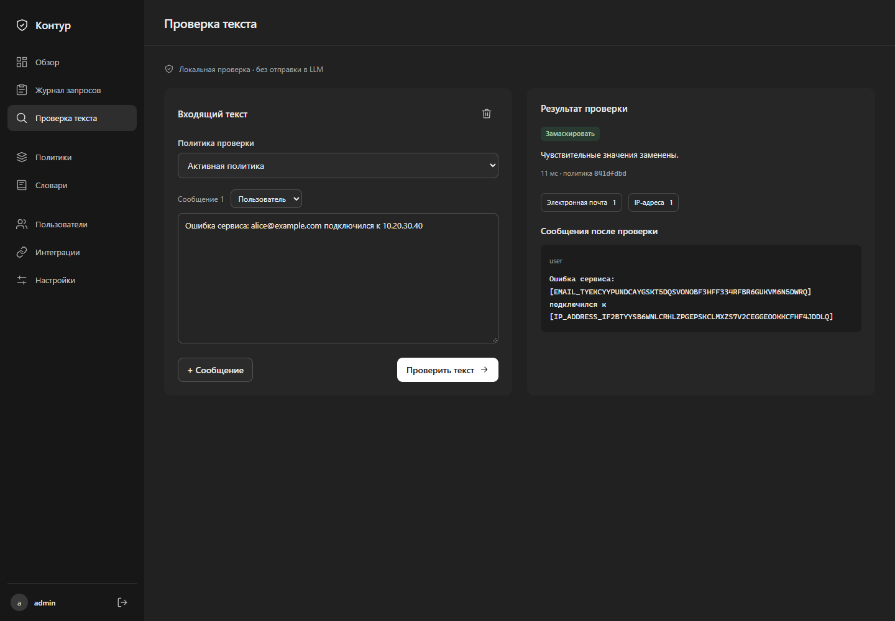
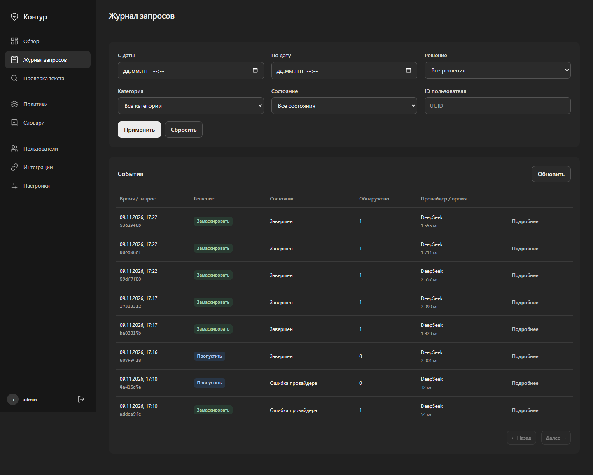
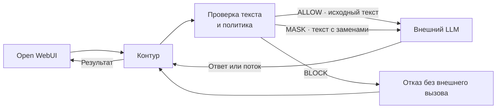
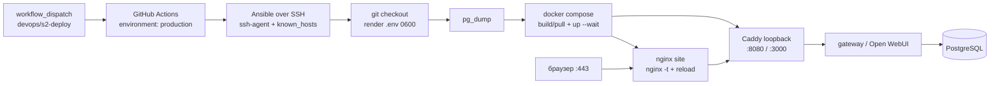
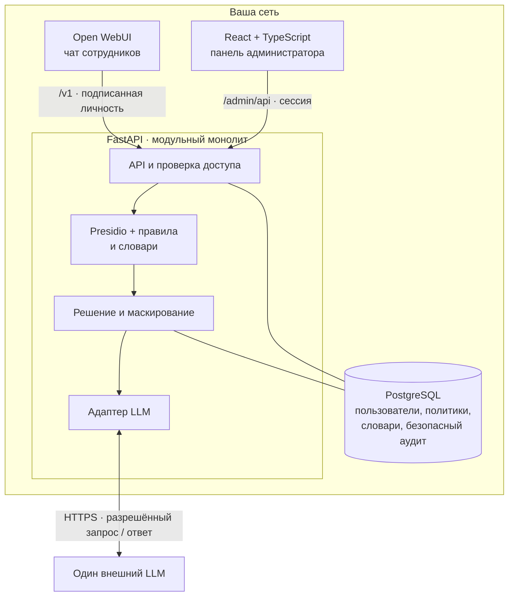

# Контур

**Проверка технических текстов перед отправкой во внешний LLM.**

В логе ошибки легко оставить токен, почту коллеги или адрес внутреннего сервера. Контур проверяет сообщения внутри вашей сети и решает, что можно отправить модели: пропустить текст, скрыть отдельные значения или остановить запрос.

Разработчик продолжает общаться в привычном чате. Администратор задаёт общие правила и видит срабатывания без исходных текстов и секретов. Готовая интеграция — Open WebUI; шлюз подключается к нему как OpenAI-совместимый провайдер.



*Проверка синтетического лога в панели. Предпросмотр работает локально и не вызывает LLM.*

## Что умеет

| Задача | Как решается |
| --- | --- |
| Не отправить доступы вместе с логом | Распознаёт поддерживаемые API-ключи, токены доступа и JWT. По умолчанию блокирует весь запрос. |
| Скрыть личные и внутренние сведения | Маскирует email, телефоны, IP из защищаемых диапазонов и внутренние имена серверов. |
| Сохранить смысл переписки | Одинаковые найденные значения получают одинаковые маркеры в пределах пользователя и диалога. |
| Задать правила для команды | Для каждой из семи категорий доступны ALLOW, MASK и BLOCK. Есть версии политик, корпоративные словари и возврат к опубликованной версии. |
| Управлять доступом | Администраторы настраивают защиту; пользователи отправляют запросы. Доступы можно отключать, ключи интеграций — перевыпускать. |
| Разобраться в срабатываниях | Журнал показывает решение, категории, время и исход запроса. Есть фильтры и статистика. |

<details>
<summary>Журнал запросов</summary>



На скриншоте — события тестового стенда. Тексты сообщений и ответы модели в журнал не записываются; срок хранения метаданных по умолчанию — 30 дней.

</details>

## Как проходит запрос



Шлюз проверяет всю поддерживаемую текстовую историю при каждом запросе. Если сработало несколько правил, BLOCK имеет приоритет над MASK, а MASK — над ALLOW. Перед внешней отправкой сохраняется событие аудита. При сбое обязательной проверки или базы запрос наружу не уходит.

Ответ модели, включая потоковый, возвращается через шлюз. Маркеры остаются в ответе: исходные значения автоматически не восстанавливаются.

## Попробовать локально

Нужны Docker с Compose v2 и Python 3.11 или 3.12. Приложение собирается в контейнерах.

```shell
git clone https://github.com/ynnmuraii/ai-gateway-for-data-protection.git
cd ai-gateway-for-data-protection
python scripts/prepare-compose.py
docker compose --env-file .env.compose up --build -d --wait
docker compose --env-file .env.compose --profile tools run --rm connect-openwebui
```

| Открыть | Адрес |
| --- | --- |
| Панель администратора | http://localhost:8080/admin/ |
| Чат Open WebUI | http://localhost:3000 |

Логины и сгенерированные пароли находятся в `.runtime/compose-access.json`: `admin_username` / `admin_password` для панели, `webui_user_email` / `webui_user_password` для чата. Повторная подготовка сохраняет существующую конфигурацию.

По умолчанию включён локальный `demo-model`: он возвращает очищенный текст и позволяет проверить маршрут без API-ключа и оплаты внешнего LLM.

1. В панели откройте **«Проверка текста»** и введите `Contact alice@example.com at 10.20.30.40`. Ожидаются замены email и IP.
2. Проверьте `access_token=SyntheticAccessToken123456789`. При начальной политике отправка блокируется.
3. Войдите в чат, выберите `demo-model` и отправьте такой же синтетический лог. Модель должна получить текст с заменами.

Для остановки с сохранением данных:

```shell
docker compose --env-file .env.compose down
```

Для настоящего LLM настройте один внешний OpenAI-совместимый endpoint. Проверена интеграция с DeepSeek Flash; [настройка провайдера, обновление и HTTPS](docs/public/operations.md).

## Деплой

Тестовый стенд разворачивается из ветки `devops/s2-deploy` через GitHub Actions. `checks.yml` запускается автоматически на push/PR. Деплой запускается вручную через `workflow_dispatch` (`confirm=deploy`) или push с маркером `[deploy]`; в push-режиме CD ждёт успешного завершения `checks.yml`. Workflow привязан к ветке: запуск из `main` или другого ref будет skipped.

### Что должно быть на сервере

- Linux, Docker Engine с Compose plugin, `git`;
- установленный и запущенный nginx;
- действующий Let's Encrypt-сертификат для домена (`fullchain.pem` и `privkey.pem`);
- DNS домена на сервер, открытые `80`/`443`/`8443`;
- SSH-пользователь с ключом; если это не `root`, то с `sudo` без пароля.

Ansible не устанавливает Docker, nginx, пакеты или сертификаты. Отдельного bootstrap-шага нет: если Docker Compose, git или nginx отсутствуют, деплой упадёт на preflight. Playbook проверяет окружение, создаёт рабочие каталоги, обновляет код, генерирует `.env`, делает backup БД, поднимает compose и обновляет nginx site.

`deploy/ansible/inventory.yml` содержит только адрес и пользователя. Приватный ключ не лежит в inventory: workflow загружает его из `DEPLOY_SSH_KEY` в `ssh-agent`, а Ansible подхватывает агент автоматически. Сейчас inventory настроен на `root`; если переключать на `tech_user`, его публичный ключ должен быть в `/home/tech_user/.ssh/authorized_keys`, а в inventory нужно поменять `ansible_user`.

### Переменные

Секреты добавляются в GitHub Environment `production`:

| Secret | Обязателен | Назначение |
|---|---|---|
| `DEPLOY_SSH_KEY` | да | приватный SSH-ключ для Ansible |
| `DEPLOY_KNOWN_HOSTS` | да | публичный host-key сервера для адреса из inventory |
| `POSTGRES_PASSWORD` | да | пароль owner-роли PostgreSQL |
| `GATEWAY_RUNTIME_PASSWORD` | да | пароль runtime-роли PostgreSQL |
| `GATEWAY_CSRF_SECRET` | да | CSRF-секрет gateway |
| `GATEWAY_PSEUDONYM_SECRET` | да | секрет псевдонимизации |
| `GATEWAY_IDENTITY_SECRET` | да | JWT-секрет gateway/Open WebUI |
| `GATEWAY_BOOTSTRAP_PASSWORD` | да | пароль администратора панели при первой инициализации |
| `GATEWAY_BOOTSTRAP_INTEGRATION_KEY` | да | ключ интеграции gateway ↔ Open WebUI |
| `GATEWAY_PROVIDER_SECRET` | при `demo=false` | API-ключ DeepSeek или другого OpenAI-совместимого провайдера |
| `WEBUI_SECRET_KEY` | да | секрет Open WebUI |
| `WEBUI_ADMIN_PASSWORD` | да | пароль админа Open WebUI при первой настройке |
| `WEBUI_USER_PASSWORD` | да | пароль демо-пользователя Open WebUI при первой настройке |

`GATEWAY_DATABASE_URL` и `GATEWAY_INSTALL_DATABASE_URL` отдельными секретами не добавляются: Ansible собирает их из паролей БД и URL-кодирует.

`DEPLOY_KNOWN_HOSTS` должен содержать host-key для того же адреса, который указан в `inventory.yml` (сейчас это IP). Иначе SSH не пройдёт проверку host key.

Нечувствительные параметры лежат в репозитории:

| Где | Что |
|---|---|
| `deploy/ansible/host_vars/gateway/main.yml` | `GATEWAY_PUBLIC_ORIGIN`, `WEBUI_URL`, nginx site/domain/aliases/cert paths/upstreams/body size/`nginx_disable_site`, provider base URL/label/model/allowed hosts, `GATEWAY_CHAT_MODEL`, `GATEWAY_DEMO_MODE`, `GATEWAY_BOOTSTRAP_USERNAME`, email’ы Open WebUI, loopback-порты Caddy |
| `deploy/ansible/group_vars/all.yml` | каталоги приложения и backup, repo URL, compose project, `deploy_ref` по умолчанию, `gateway_image`, флаг повторного `connect-openwebui` |
| `deploy/env/openwebui.env` | статические флаги Open WebUI |
| `deploy/env/gateway.env` | `GATEWAY_DETECTOR_WORKERS`, `GATEWAY_DETECTOR_QUEUE_SIZE` |
| `deploy/env/postgres.env` | `POSTGRES_DB`, `POSTGRES_USER`, `POSTGRES_INITDB_ARGS` |

Ansible генерирует `/opt/confidential-ai-gateway/.env` с правами `0600`. В нём лежат секреты и значения для `${...}`-подстановки Compose. В репозиторий этот файл не попадает.

Важно:

- `POSTGRES_PASSWORD` и `GATEWAY_BOOTSTRAP_INTEGRATION_KEY` должны оставаться стабильными после первой установки;
- `GATEWAY_RUNTIME_PASSWORD` можно менять — `install` обновляет роль;
- `GATEWAY_BOOTSTRAP_PASSWORD` действует только при первой инициализации БД;
- `WEBUI_ADMIN_PASSWORD` и `WEBUI_USER_PASSWORD` используются при первичной настройке Open WebUI;
- смена `GATEWAY_CSRF_SECRET`, `GATEWAY_PSEUDONYM_SECRET`, `GATEWAY_IDENTITY_SECRET` или `WEBUI_SECRET_KEY` инвалидирует сессии/маркеры;
- `GATEWAY_PROVIDER_SECRET` можно ротировать, после чего gateway пересоздаётся при деплое.

### Как запускать

1. Заполнить `deploy/ansible/inventory.yml` — адрес и пользователь.
2. Проверить `deploy/ansible/host_vars/gateway/main.yml` — домен, пути к сертификату, provider, `nginx_disable_site`.
3. Создать GitHub Environment `production`, добавить секреты из таблицы и, по желанию, required reviewers.
4. Убедиться, что DNS и Let's Encrypt-сертификат уже действуют на сервере.
5. Запустить workflow из ветки `devops/s2-deploy`:

```shell
gh workflow run deploy.yml \
  --ref devops/s2-deploy \
  -f confirm=deploy
```

Или в GitHub UI: **Actions → deploy → Run workflow**, ветка `devops/s2-deploy`, `confirm=deploy`.

Альтернатива без UI — push с маркером `[deploy]`:

```shell
git commit --allow-empty -m "chore(deploy): run [deploy]"
git push origin devops/s2-deploy
```

CD запустится после push, дождётся успешного `checks.yml` на этом SHA и только затем выполнит Ansible. Обычные push без `[deploy]` создают skipped-run и ничего не деплоят.

`connect_openwebui` по умолчанию `false`: на первой установке провижининг Open WebUI запускается автоматически. Поставь `true`, если нужно принудительно повторить его на существующем стенде:

```shell
gh workflow run deploy.yml \
  --ref devops/s2-deploy \
  -f confirm=deploy \
  -f connect_openwebui=true
```

### Что делает деплой



Порядок в playbook:

1. проверяет `sudo -n`, Docker Compose, git и nginx;
2. создаёт `/opt/confidential-ai-gateway` и `/opt/confidential-ai-gateway-backups`;
3. обновляет исходники до SHA ветки;
4. генерирует `.env`;
5. делает `pg_dump` перед миграциями;
6. собирает/подтягивает образ, запускает `install`, останавливает gateway, обновляет detector-профили;
7. поднимает стек и ждёт healthy;
8. на первой установке запускает `connect-openwebui`;
9. создаёт `/etc/nginx/sites-available/confidential-ai-gateway.conf`, валидирует `nginx -t` и перезагружает nginx.

| Открыть | Адрес |
| --- | --- |
| Панель администратора | `https://sk1fix.website/admin/` |
| Чат Open WebUI | `https://sk1fix.website/` |

`www.sk1fix.website` и `:8443` редиректят на канонический `https://sk1fix.website`; `/v1` снаружи закрыт. TLS терминирует host nginx. Caddy внутри compose остаётся на loopback как внутренний маршрутизатор/фильтр и TLS не терминирует.

Полный список секретов, nginx-маршруты и ручные операции — в [operations.md](docs/public/operations.md).

## Из чего состоит



Python/FastAPI обрабатывает запросы, Presidio ищет email и телефоны, собственные распознаватели дополняют проверку секретов и инфраструктурных сведений. PostgreSQL хранит настройки и безопасные события. React/TypeScript отвечает за панель, Docker Compose — за запуск. Исходные значения для обратной подстановки не сохраняются.

## Где заканчивается защита

Текущая версия рассчитана на одну организацию, общую политику и текстовый Chat Completions: роли system/user/assistant, обычный ответ и SSE. Для другого чат-клиента потребуется адаптировать передачу доверенной личности пользователя — одного URL и API-ключа недостаточно.

- Поддерживаемые форматы ограничены: например, телефоны RU/US/GB, JWT и известные сигнатуры ключей. Неизвестный или закодированный секрет может остаться незамеченным. [Форматы и ограничения детектора](docs/public/detection.md).
- Защита не распространяется на файлы, изображения, вызовы tools, RAG и несколько LLM-провайдеров.
- Ответ LLM не проходит DLP-проверку. Open WebUI хранит историю отдельно; его хранение и доступы нужно учитывать при развёртывании.
- Маскирование не гарантирует анонимность: часть сведений может быть понятна из оставшегося контекста.

## Для разработки

[Запуск тестов и оценка детектора](docs/public/development.md) · [Развёртывание и обновление](docs/public/operations.md) · [API-контракт](openapi.json) · [Устройство панели](frontend/README.md) · [Правила интерфейса](frontend/DESIGN.md)
