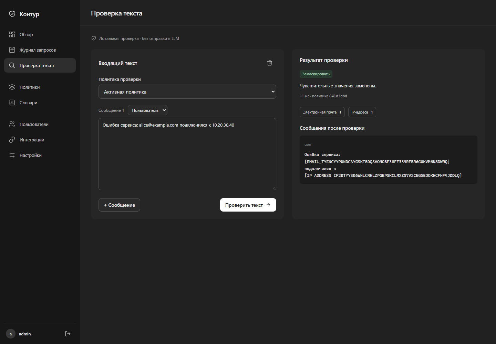
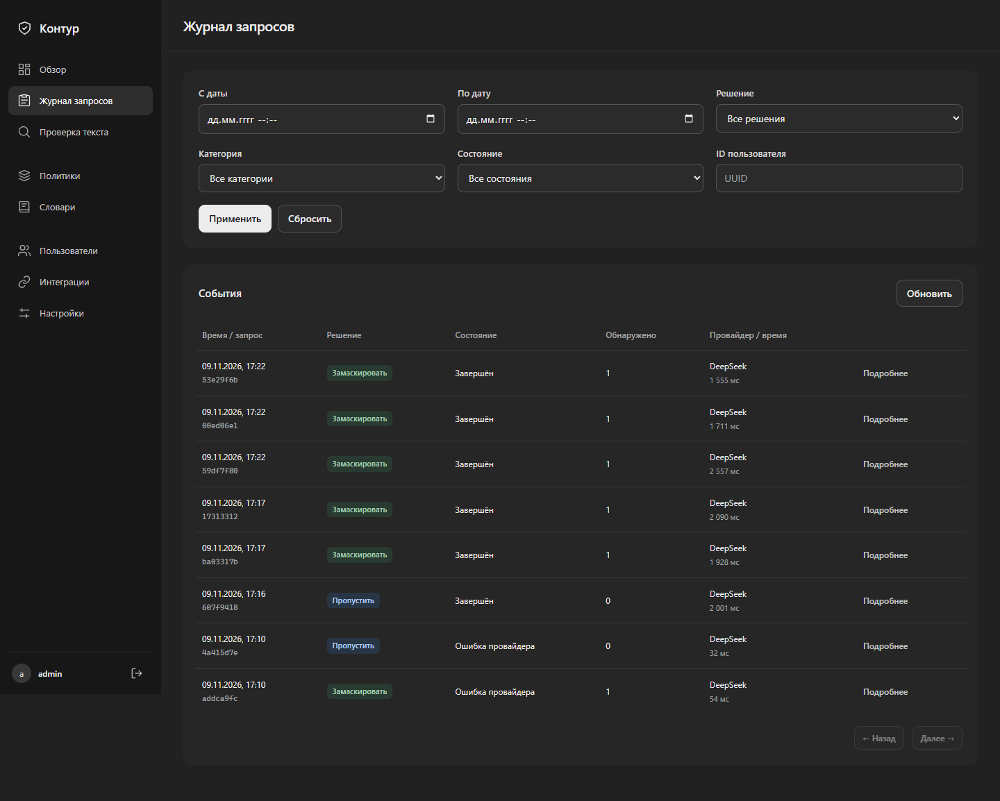
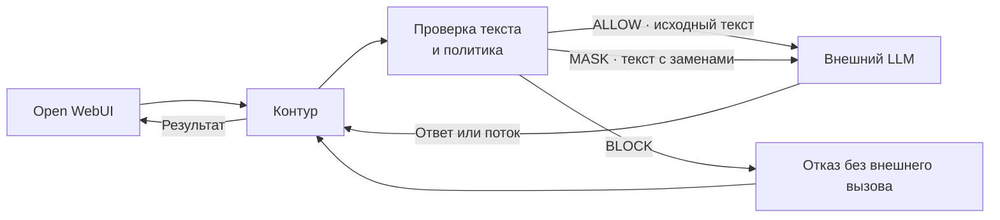
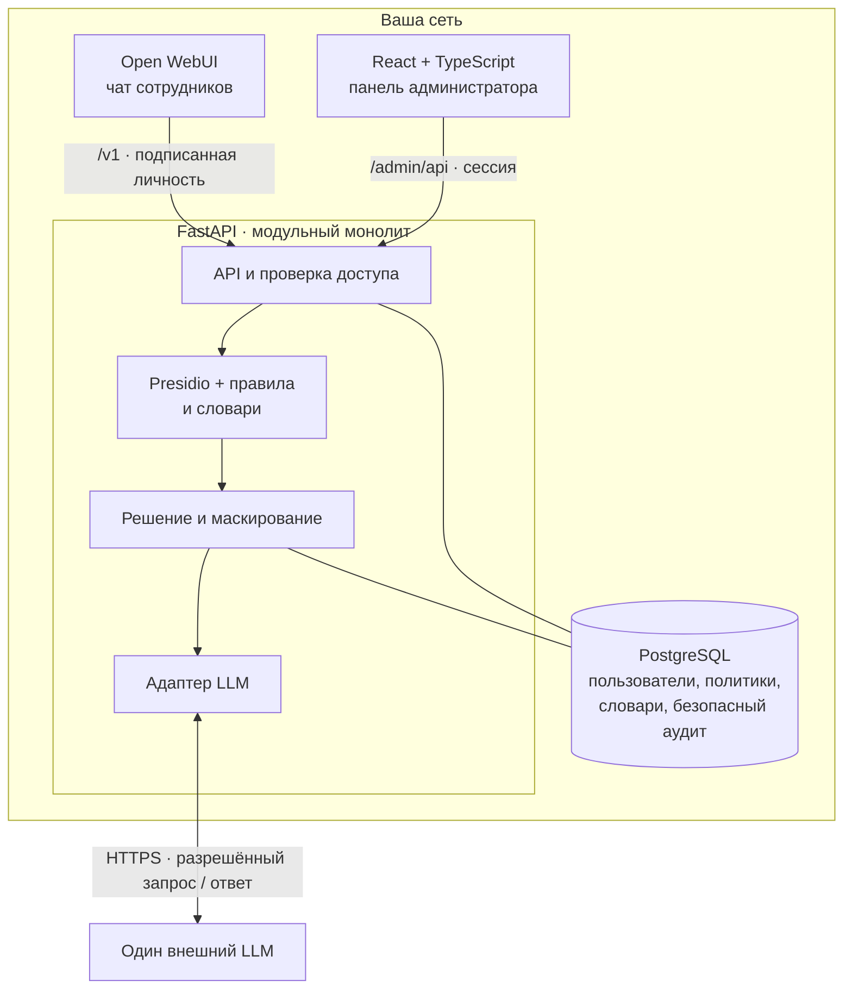

# Контур

**Проверка технических текстов перед отправкой во внешний LLM.**

В логе ошибки легко оставить токен, почту коллеги или адрес внутреннего сервера. Контур проверяет сообщения внутри вашей сети и решает, что можно отправить модели: пропустить текст, скрыть отдельные значения или остановить запрос.

Разработчик продолжает общаться в привычном чате. Администратор задаёт общие правила и видит срабатывания без исходных текстов и секретов. Готовая интеграция — Open WebUI; шлюз подключается к нему как OpenAI-совместимый провайдер.



*Проверка синтетического лога в панели. Предпросмотр работает локально и не вызывает LLM.*

## Что умеет

| Задача | Как решается |
| --- | --- |
| Не отправить доступы вместе с логом | Распознаёт поддерживаемые API-ключи, токены доступа и JWT. По умолчанию блокирует весь запрос. |
| Скрыть личные и внутренние сведения | Маскирует email, телефоны, IP из защищаемых диапазонов и внутренние имена серверов. |
| Сохранить смысл переписки | Одинаковые найденные значения получают одинаковые маркеры в пределах пользователя и диалога. |
| Задать правила для команды | Для каждой из семи категорий доступны ALLOW, MASK и BLOCK. Есть версии политик, корпоративные словари и возврат к опубликованной версии. |
| Управлять доступом | Администраторы настраивают защиту; пользователи отправляют запросы. Доступы можно отключать, ключи интеграций — перевыпускать. |
| Разобраться в срабатываниях | Журнал показывает решение, категории, время и исход запроса. Есть фильтры и статистика. |

<details>
<summary>Журнал запросов</summary>



На скриншоте — события тестового стенда. Тексты сообщений и ответы модели в журнал не записываются; срок хранения метаданных по умолчанию — 30 дней.

</details>

## Как проходит запрос



Шлюз проверяет всю поддерживаемую текстовую историю при каждом запросе. Если сработало несколько правил, BLOCK имеет приоритет над MASK, а MASK — над ALLOW. Перед внешней отправкой сохраняется событие аудита. При сбое обязательной проверки или базы запрос наружу не уходит.

Ответ модели, включая потоковый, возвращается через шлюз. Маркеры остаются в ответе: исходные значения автоматически не восстанавливаются.

## Попробовать локально

Нужны Docker с Compose v2 и Python 3.11 или 3.12. Приложение собирается в контейнерах.

```shell
git clone https://github.com/ynnmuraii/ai-gateway-for-data-protection.git
cd ai-gateway-for-data-protection
python scripts/prepare-compose.py
docker compose --env-file .env.compose up --build -d --wait
docker compose --env-file .env.compose --profile tools run --rm connect-openwebui
```

| Открыть | Адрес |
| --- | --- |
| Панель администратора | http://localhost:8080/admin/ |
| Чат Open WebUI | http://localhost:3000 |

Логины и сгенерированные пароли находятся в `.runtime/compose-access.json`: `admin_username` / `admin_password` для панели, `webui_user_email` / `webui_user_password` для чата. Повторная подготовка сохраняет существующую конфигурацию.

По умолчанию включён локальный `demo-model`: он возвращает очищенный текст и позволяет проверить маршрут без API-ключа и оплаты внешнего LLM.

1. В панели откройте **«Проверка текста»** и введите `Contact alice@example.com at 10.20.30.40`. Ожидаются замены email и IP.
2. Проверьте `access_token=SyntheticAccessToken123456789`. При начальной политике отправка блокируется.
3. Войдите в чат, выберите `demo-model` и отправьте такой же синтетический лог. Модель должна получить текст с заменами.

Для остановки с сохранением данных:

```shell
docker compose --env-file .env.compose down
```

Для настоящего LLM настройте один внешний OpenAI-совместимый endpoint. Проверена интеграция с DeepSeek Flash; [настройка провайдера, обновление и HTTPS](docs/public/operations.md).

## Из чего состоит



Python/FastAPI обрабатывает запросы, Presidio ищет email и телефоны, собственные распознаватели дополняют проверку секретов и инфраструктурных сведений. PostgreSQL хранит настройки и безопасные события. React/TypeScript отвечает за панель, Docker Compose — за запуск. Исходные значения для обратной подстановки не сохраняются.

## Где заканчивается защита

Текущая версия рассчитана на одну организацию, общую политику и текстовый Chat Completions: роли system/user/assistant, обычный ответ и SSE. Для другого чат-клиента потребуется адаптировать передачу доверенной личности пользователя — одного URL и API-ключа недостаточно.

- Поддерживаемые форматы ограничены: например, телефоны RU/US/GB, JWT и известные сигнатуры ключей. Неизвестный или закодированный секрет может остаться незамеченным. [Форматы и ограничения детектора](docs/public/detection.md).
- Защита не распространяется на файлы, изображения, вызовы tools, RAG и несколько LLM-провайдеров.
- Ответ LLM не проходит DLP-проверку. Open WebUI хранит историю отдельно; его хранение и доступы нужно учитывать при развёртывании.
- Маскирование не гарантирует анонимность: часть сведений может быть понятна из оставшегося контекста.

## Для разработки

[Запуск тестов и оценка детектора](docs/public/development.md) · [Развёртывание и обновление](docs/public/operations.md) · [API-контракт](openapi.json) · [Устройство панели](frontend/README.md) · [Правила интерфейса](frontend/DESIGN.md)
